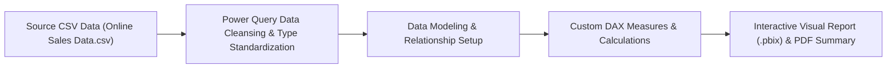

# 📊 Marketing & Sales Analytics Dashboard — Power BI

<p align="center">
  
</p>

<p align="center">
  An interactive 5-page marketing and sales business analytics dashboard built using <b>Microsoft Power BI</b> analyzing transactional sales data across regions, payment channels, and product categories to uncover commercial growth drivers.
</p>

<p align="center">
  <a href="https://github.com/prakruthidevanga/Marketing-Sales-Analytics-Dashboard">
    
  </a>
</p>

<p align="center">
  
  
  
  
</p>

---

## 📌 Table of Contents

- [📖 Project Overview](#-project-overview)
- [🎯 Objectives](#-objectives)
- [✨ Key Features](#-key-features)
- [📊 Dashboard Architecture & Views](#-dashboard-architecture--views)
- [🛠️ Technology Stack](#️-technology-stack)
- [📁 Repository Structure](#-repository-structure)
- [⚙️ How to View & Explore](#️-how-to-view--explore)
- [🔮 Future Enhancements](#-future-enhancements)
- [🤝 Contributing](#-contributing)
- [👩‍💻 Author & Accreditations](#-author--accreditations)

---

## 📖 Project Overview

Understanding online customer acquisition channels, product return patterns, and revenue contribution across territories is vital for marketing resource allocation. Raw sales transactions stored in spreadsheets provide little immediate visibility into real business performance.

The **Marketing & Sales Analytics Dashboard** provides an executive data visualization suite that ingests multi-attribute sales transactions, performs data transformation in **Power Query**, and authors **10+ DAX measures** to track profitability, order fulfillment velocity, and customer purchasing habits across global markets.

📊 **Core Mission:** Provide clear, interactive business intelligence to guide marketing investments and retail inventory distribution.

---

## 🎯 Objectives

- 📈 **Evaluate Sales Velocity:** Track daily, monthly, and quarterly revenue volume across 240+ multi-category transactions.
- 🛍️ **Analyze Product Margins:** Segment inventory into high-volume vs. high-margin merchandise.
- 👥 **Examine Payment & Channel Trends:** Identify popular transaction methods across Credit Cards, PayPal, and Bank Transfers.
- 🗺️ **Territory Performance:** Map geographic distributions to identify underserved markets.

---

## ✨ Key Features

### 1. 📈 Multi-Page Executive Views
Structured interactive report pages covering overall revenue, product category shares, payment distribution, and temporal performance.

### 2. 🧮 10+ Custom DAX Measures
Formulated key metrics including Average Order Value ($AOV$), Unit Contribution Margins, Return Rate %, and Sales Growth.

### 3. 🔎 Dynamic Drill-Through Slicers
Contextual date range, region, and product category filters that update all visual containers synchronously.

---

## 📊 Dashboard Architecture & Views



---

## 🛠️ Technology Stack

<p align="center">
  
</p>

| Component | Technology | Implementation Role |
| :--- | :--- | :--- |
| **BI Tool** | Microsoft Power BI Desktop | Dashboard layout, charts, and interactive filtering |
| **ETL Engine** | Power Query | Cleansing, currency normalization, and column derivations |
| **Formulas** | DAX | Dynamic KPIs, ratios, and time-intelligence aggregations |
| **Documentation** | Adobe PDF Report | Formal academic and technical project deliverable |

---

## 📁 Repository Structure

```text
Marketing-Sales-Analytics-Dashboard/
├── Online sales data.pbix                              # Complete Power BI interactive model
├── Online Sales Data.csv                               # Clean transactional source dataset
├── DWM_Project_Retport_Pakruthi_BR_(Online_Sales).pdf   # Formal project and analytical report
└── README.md                                           # Project documentation
```

---

## ⚙️ How to View & Explore

1. Install [Microsoft Power BI Desktop](https://powerbi.microsoft.com/desktop/).
2. Clone this repository:
   ```bash
   git clone https://github.com/prakruthidevanga/Marketing-Sales-Analytics-Dashboard.git
   cd Marketing-Sales-Analytics-Dashboard
   ```
3. Open `Online sales data.pbix` in Power BI Desktop to interact with the visualizations!

---

## 🔮 Future Enhancements

- 🔮 **Predictive Sales Forecasting:** Add exponential smoothing forecasts for next-quarter orders.
- 🔄 **Real-Time Database Connector:** Link dashboard directly to an active MySQL cloud database.

---

## 🤝 Contributing

Feedback and analytical enhancements are welcome! Feel free to fork and open a pull request.

---

## 👩‍💻 Author & Accreditations

**Prakruthi B R**  
*BCA Student specializing in Artificial Intelligence & Machine Learning*  
*Alliance University, Bengaluru (CGPA: 9.60)*  
*GeeksforGeeks Campus Mantri (2026)*

- 💻 **GitHub:** [@prakruthidevanga](https://github.com/prakruthidevanga)
- 🔗 **LinkedIn:** [Prakruthi BR](https://linkedin.com/in/prakruthi-br)
- 🌐 **Portfolio:** [prakruthidevanga.github.io](https://prakruthidevanga.github.io/)
- 📬 **Email:** [prakruthibr2006@gmail.com](mailto:prakruthibr2006@gmail.com)

---

<p align="center">
  <b>📊 Turning transactional records into strategic commercial decisions.</b>
</p>

<p align="center">
  
</p>
